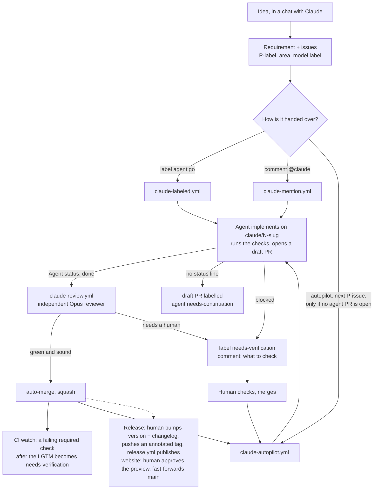

# How it works

This is the set-up I use to let Claude agents work on my GitHub repos while I
stay in charge of direction. I describe what I want, the issues get written,
and most of them are implemented, reviewed and merged without me touching
the code. I only hear about an issue when it is unclear or needs a human
check, and I still decide when a release goes out.

The standard came out of real use: first on
[`hass-meteoswiss-radar`](https://github.com/chriguschneider/hass-meteoswiss-radar)
and [`weather-station-card`](https://github.com/chriguschneider/weather-station-card),
then on [`hass-meteoswiss-weather`](https://github.com/chriguschneider/hass-meteoswiss-weather),
where an integration went from an idea to v0.5.0 with most of the code
written by agents. Every guard below exists because something went wrong
once.

## The loop

Three ways in, one way out:

- **`agent:go` label** — the opt-in. An issue without the label is never
  touched, so a repo full of loose ideas is safe.
- **`@claude` comment** — for a quick change or a question on an issue or PR.
- **Autopilot** (only in repos that have an ordered backlog) — takes the next
  P1, then P2, then P3 issue, but only while no agent PR is open. One PR at
  a time means no two agents edit the same file and the quota never spikes.

Whatever the entry, the result is a **draft PR on a `claude/<n>-<slug>`
branch**. The default branch is protected; nothing lands without the
required checks.

The agent runs with an explicit tool allowlist, never with
`--dangerously-skip-permissions`: git, a handful of `gh` subcommands and the
repo's own check commands. It only acts on text written by people with
write access, and it cannot write to `.github/` or `.claude/`. See
[Guardrails](../common/docs/agent-automation.md#guardrails) for the layers.

## The reviewer

The author and the reviewer are different runs with different models:
Sonnet (or whatever the labels pick) writes, Opus reviews, so nothing grades
its own work. The reviewer reads the conventions and decisions first, reviews
adversarially, reads the CI result (it never runs the PR's own scripts,
because the PR could have changed them), fixes real problems itself (at
most three rounds) and then makes one call:

- **auto-merge** when the checks are green and the change is sound, or
- **hold** with `needs-verification` and a comment saying exactly what a
  human must look at — only when a live system or a decision is genuinely
  needed. Anyone can add the label to force a human check.

The default is to merge. A reviewer that holds everything "to be safe" just
moves the bottleneck back to me.

## Picking the model

`pick-model.sh` maps labels to a model: `agent:opus|sonnet|haiku` override,
otherwise P1 → Opus, P3 or `good first issue` → Haiku, everything else →
Sonnet. The rule of thumb: if the result can be judged right or wrong in ten
seconds, Haiku; if it needs an idea but no design, Sonnet; if it can break
the architecture or the cause is unclear, Opus. Aliases are used instead of
pinned model IDs so the workflows don't go stale with every release.

## The repo is the memory

Agents start from zero every run, so everything they need is in the repo:

- **`AGENTS.md`** — conventions for any AI assistant (and humans): branch
  names, draft PRs, changelog rule, release procedure, how to test, and the
  non-negotiables of this repo.
- **`docs/adr/`** — short architecture decision records. The workflows tell
  the agent to stop rather than break one, and the reviewer checks against
  them.
- **Two repo-local Claude Code skills** — `commit-guardian` checks a staged
  diff against the ADRs before a commit; `documentation-guardian` proposes an
  ADR when a change is architectural.
- **`CHANGELOG.md`** — written as part of every user-visible PR, so a
  release is a rename of `[Unreleased]`, not an archaeology session.

## Lessons that became guards

| What happened | Guard in the standard |
|---|---|
| A fresh repo without the secret had red workflows from day one | Every agent workflow checks for `CLAUDE_CODE_OAUTH_TOKEN` and skips with a notice |
| The action could not get its GitHub App token | `id-token: write` on every agent job |
| Agent pushes went out as `github-actions[bot]`, their CI sat in "action required" | `persist-credentials: false` on checkout |
| The reviewer never ran on PRs opened by the agent bot | `allowed_bots: "claude"` on the reviewer and autopilot |
| `@claude` comments from strangers run with access to secrets on public repos | Mention workflow gated to OWNER / MEMBER / COLLABORATOR |
| An autonomous agent should not rewrite its own CI | A path guard hook blocks every write to `.github/` and `.claude/`; the token's scope is not relied on (the Claude app is installed with Workflows write) |
| A crafted issue made Claude dump its environment and mint a write token (CVE-2025-66032); an issue title led to a poisoned npm release (Clinejection, 2026) | No `--dangerously-skip-permissions`: a tool allowlist, deny rules, egress control with harden-runner, only issue text from people with write access |
| The reviewer ran the PR's own test scripts in a job that holds secrets | The reviewer reads CI results instead; PRs touching CI, agent config, ADRs or dependencies are held for a human by a deterministic step |
| A tag-pinned action was rewritten upstream to steal secrets (tj-actions/changed-files, 2025) | Every action pinned by commit SHA; Dependabot bumps after a 7-day cooldown |
| A release used a build cache an earlier, untrusted job could have filled | No package-manager cache in release workflows |
| A reviewer that commits would re-trigger itself forever | Review runs on PR opened / ready only, not on push |
| `strict` branch protection made every second PR "behind" | `strict` off, checks still required (merge queues are org-only) |
| Auto-merge was armed, then hassfest failed — the PR sat silently for hours | The reviewer job waits for the checks and hands a failure to a human |
| GitHub fired the 30-minute cron only about every 10 hours | Autopilot also advances on merged PRs, finished CI/review runs and label changes |
| A run that hit the turn cap left nothing behind and was retried forever | The agent pushes early; `after-agent-run.sh` saves whatever is left to a draft PR labelled `agent:needs-continuation`, or, if nothing was committed, labels the issue and asks to split it, so it is not retried |
| A finished run was failed for going two turns over the limit | The agent ends the PR description with `Agent status: done`; that line, not the exit status, decides what happens next |
| The reviewer reviewed a draft while the agent was still writing it, and its own `gh pr ready` started a second review of every PR | The reviewer starts when the agent reports done or a human marks the PR ready, and skips events sent by itself |
| A contributor's fork PR on a `claude/...` branch (Claude Code's default branch name) was taken for an agent PR and stalled the autopilot | Reviewer and autopilot gate only count same-repository branches |
| The agent could not change a workflow, described the change, wrote `Closes #N` -- the issue closed, the change never happened (4 of 7 ADRs in one repo) | `Refs #N` plus a `## Human-only change` section; the reviewer holds the PR and opens a follow-up issue |
| CI was red on the default branch for 15 days and a release went out on top | Weekly CI run, `ci-watch.yml` opens an issue, `release.yml` requires a green CI run on the tagged commit |
| A lookup table the agent invented shipped in a release; hand-written fixtures hid a broken default behind 100 green tests | Domain data cites a source (`docs/upstream.md`), fixtures are trimmed real files |
| Two agent PRs for the same issue blocked the autopilot for 11 days | The agent first checks the issue is open and has no PR; the autopilot names the blocking PR in its summary |
| A push with the workflow token never started the follow-up workflow | Known GitHub rule (no recursion); where a follow-up must run, start it with `gh workflow run` |
| A conflict in a committed bundle was merged by hand and shipped broken | Rebuild on conflict, never hand-merge generated files; CI checks committed output against its sources |
| A README image vanished in HACS after a rename | HACS shows the README frozen at the release tag and strips relative paths and `<picture>`: absolute URLs, never renamed between releases |
| The card editor's defaults drifted from the runtime defaults; a row vanished on a live dashboard | One source of defaults, and a test that the editor schema covers the stub config |
| A dev-only `npm audit` finding blocked unrelated PRs three times | Only runtime advisories block (`--omit=dev`); the full audit reports |
| The repo had agent workflows but no tests; the agent was never used | A test suite is a precondition for `agent:go` (docs: *Sizing an issue*) |
| A release was cut from a tag that did not match the code | Release only if the tag equals the declared version and the changelog has a non-empty section |
| The release title showed the commit subject instead of the tag message | Title read from the annotated tag via the API (checkout overwrites the tag locally) |
| HACS showed zero downloads | Integrations ship a zip asset with `zip_release`, guarded by a test |
| Two agents on the same file meant a merge conflict on the second PR | One agent PR at a time in autopilot; parallel work only along module boundaries |

## What stays human

- **Direction**: which issues exist and in which order (P-labels).
- **Secrets**: the Claude token and any other secret are set by the owner,
  never by an agent and never in a chat.
- **Workflow changes**: done with the owner's own login, not by the agent.
- **Releases**: a human bumps the version and pushes the tag.
- **Anything labelled `needs-verification`.**

## Outside the repo (optional)

I keep a personal knowledge base in Obsidian. Every repo has a project note
there with the context that does not belong in the repo (why the project
exists, research, operating experience), and a `repo/` folder that only
holds symlinks to the repo's README, AGENTS.md, CHANGELOG and docs, so the
documentation is readable next to my notes without copying it.
`check.py --vault` checks that link. If you don't use Obsidian, ignore the
flag; nothing else depends on it.
